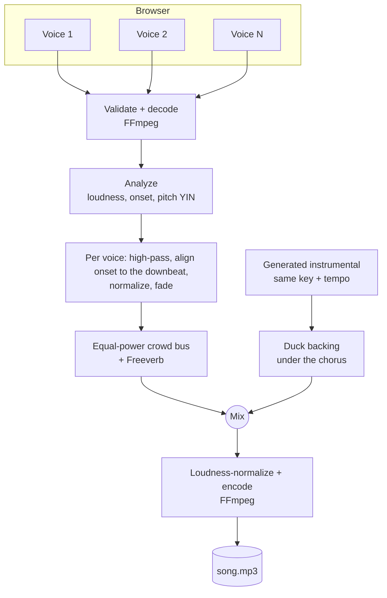
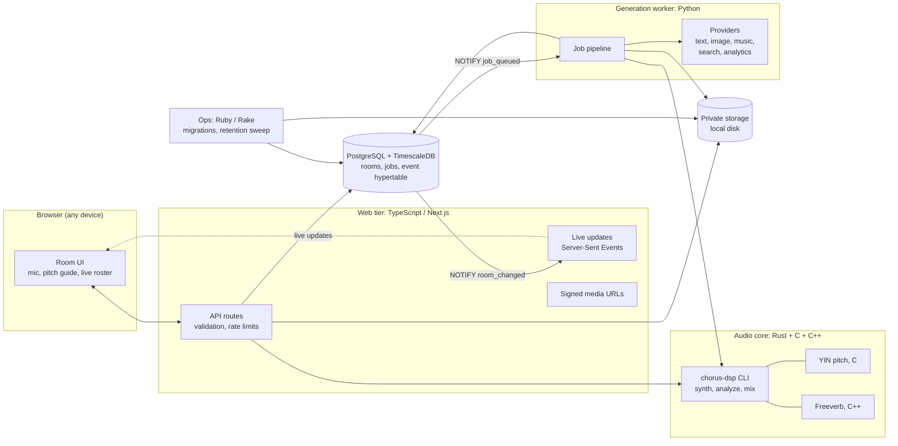
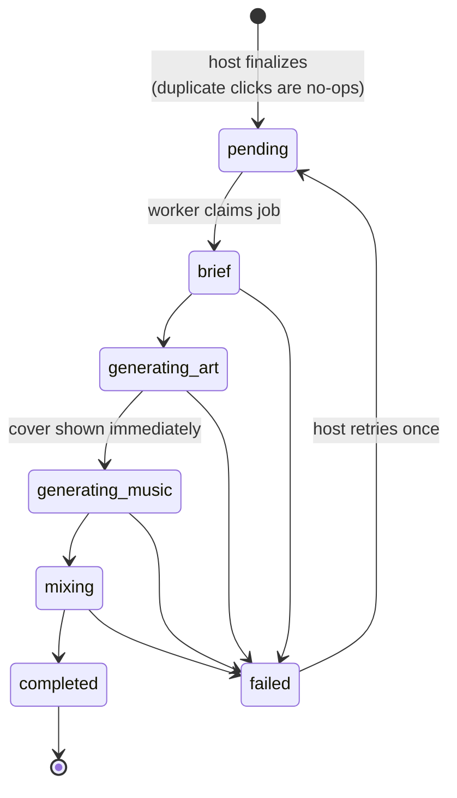

# CrowdChorus

**One room. Many voices. One original song.**

CrowdChorus is an open-source, browser-based music studio for groups. People
join a room from their phones or laptops, each sings the same short original
line, and the room produces one finished track that has their real voices on
it, over a newly generated instrumental, with its own album cover and a page
you can share.

No accounts, no installs, no musical training, no studio. It runs on your
machine with zero API keys, and every AI or cloud service it can use is a
swappable plug-in.

---

## Why this exists

Making music together usually takes skills, instruments, recording gear,
editing and a lot of coordination. AI music tools made creation easier, but
they're built around **one person typing one prompt**. The result belongs to
the prompt, not to a group of people.

CrowdChorus asks a different question:

> Can a room full of people with different voices and abilities make one
> shared piece of music, through a single simple browser experience, and
> leave with something that actually contains them?

The answer the product commits to: **the AI makes the backing, the people make
the song.** Their recordings are mixed into the final track. They aren't just
used as a prompt and thrown away.

## Who it's for

| You are… | You use it for… |
|---|---|
| **Event and hackathon hosts** | A 3-minute group moment that leaves every attendee with a song they're on |
| **Teachers and workshop leaders** | A low-pressure way for a class to make something together, no instruments needed |
| **Remote teams** | An offsite or all-hands ritual that works over a video call |
| **Community groups, choirs, families** | Turning a gathering, a cause or a memory into a track and a cover |
| **Developers and researchers** | A hackable reference for multi-user audio capture, crowd mixing and pluggable generative pipelines |

## What happens in a session

```mermaid
flowchart LR
    A([Host creates a room]) --> B[Share link or QR code]
    B --> C[People join with a nickname<br/>and pick a mood]
    C --> D[Everyone gets the same<br/>original chorus line]
    D --> E[Pitch guide + count-in<br/>then a 6-second recording]
    E --> F{Happy with it?}
    F -- retry --> E
    F -- consent + submit --> G[Live roster fills up]
    G --> H([Host closes the round])
    H --> I[Creative brief from the<br/>room's moods, themes and voices]
    I --> J[Album cover]
    J --> K[Instrumental in the<br/>shared key and tempo]
    K --> L[Crowd voices mixed in]
    L --> M([Shareable results page:<br/>cover, song, real metrics])
```



There are exactly three user-facing features:

1. **Join and contribute.** Room code, roster, shared chorus line, pitch guide, record, preview, retry, withdraw, submit.
2. **Generate the collective single.** Brief, cover, instrumental, mix, with honest per-step status.
3. **Share the result.** Cover, player, download, share link, measured session metrics.

## How the voices end up in the song

Generative music models make instrumentals from text (and sometimes images).
They don't take a crowd's recordings as input. So CrowdChorus does the
human part itself, with a deterministic audio engine:



Everything musical (tempo, key, chord progression, the 8-note motif, where the
chorus lands) lives in one file, [`music.json`](music.json). The browser pitch
guide, the instrumental prompt and the mixer all read it, so the crowd sings
in the key the backing was built on.

The audio engine has a test proving that **removing any single voice
measurably changes the chorus**. No one gets mixed into silence.

## Architecture

A modular monolith: one repository, one database. Components hand work to
each other through **database rows**, **files** and **command-line tools that
print JSON**, never service-to-service HTTP. Each language does what it's best at.



| Layer | Language | Why this language |
|---|---|---|
| Web UI and API | TypeScript (Next.js) | The browser needs it; one codebase for pages and routes |
| Audio engine | Rust | Fast, memory-safe sample processing with no runtime |
| Pitch detection | C | YIN is a tight numeric loop; C is its natural home |
| Reverb | C++ | Freeverb's classic comb/allpass classes |
| Media I/O | FFmpeg (C) | Decodes whatever any browser records, encodes the final file |
| Generation pipeline | Python | Every AI, search and warehouse SDK is first-class in Python |
| Ops tasks | Ruby (Rake) | Migrations, dev orchestration, scheduled retention |

The full cross-language contract (storage layout, state machines, JSON shapes,
CLIs) is in [`docs/ARCHITECTURE.md`](docs/ARCHITECTURE.md).

### Generation job lifecycle



A step shows as done only when it actually succeeded. If a provider fails, the
step falls back to a local implementation and the results page **says so**
("Prepared demo backing, not generated for this room"). It never passes off a
fallback as a fresh generation.

## Vendor-agnostic by design

Every external capability is a provider behind a small interface. With no keys
set, everything runs on the `local` provider, so the whole product works
offline. Add a key and that capability upgrades. Add a vendor by writing one file.

| Capability | `local` (default, no keys) | Included vendor adapters | Swap in… |
|---|---|---|---|
| Lyrics and creative brief | Template writer | Google Gemini | Any LLM with JSON output |
| Album cover | Procedural abstract art | Gemini image (Nano Banana) | Any text-to-image model |
| Instrumental | Prepared demo backing (labelled) | Google Lyria | Any text-to-music model |
| Theme inspiration | Off | Nimble search | Any web-search API |
| Cross-session analytics | Queries the app database | Snowflake | Any warehouse |
| Monitoring | Off | Sentry | Any error tracker |
| Database | PostgreSQL + TimescaleDB in Docker | Tiger Data (hosted TimescaleDB) | Any Postgres 15+ |
| Media storage | Private local folder | (planned) S3-compatible: R2, S3, MinIO | Any object store |

See [`worker/providers/README.md`](worker/providers/README.md) to add a provider.

## Privacy

Voices are personal, and the defaults treat them that way.

- People are asked before recording and told their voice will be mixed into a shared track.
- No background recording. No voice cloning. No identity inference.
- Individual recordings are private, never get a public URL, and are deleted
  after `RETENTION_HOURS` (default 24). Only the mixed song remains.
- Anyone can withdraw a recording until the host finalizes.
- Analytics and monitoring get counts and timings only: no audio, nicknames, themes or lyrics.
- No server-side fetching of user-supplied URLs. API keys stay on the server.

## Quick start

Requirements: Docker, Node 22+ with pnpm, Rust (stable), Python with
[uv](https://docs.astral.sh/uv/), Ruby with Rake, FFmpeg.

```bash
git clone https://github.com/roshaninfordham/crowdchorus.git
cd crowdchorus
pnpm install
cp .env.example .env.local     # optional: every key is optional
rake dev                       # database, migrations, audio engine, worker, web
```

Open <http://localhost:3000>, create a room, and use **Add simulated singer** to
try the whole flow alone. To test with phones on the same network, serve over
HTTPS (`pnpm dev --experimental-https`): browsers only allow the microphone
on secure origins.

```bash
rake -T          # every task
rake test        # Rust, Python and TypeScript suites (uses a separate crowdchorus_test DB)
rake e2e         # three-browser Playwright run with fake microphones (stop `rake dev` first)
```

## Project status

An early, working prototype. It measures what it can observe: participation,
submissions, retries, generation time. It makes no claims about wellbeing,
learning or social impact. Those are hypotheses for future study.

Not yet included: pitch correction, beat-accurate alignment to arbitrary
generated tempos, stereo mixing, and multi-process rate limiting. Contributions welcome.

## Contributing

Read [`CONTRIBUTING.md`](CONTRIBUTING.md). Good first areas: new providers, new
`music.json` motifs, accessibility, and mix quality.

## License

[MIT](LICENSE)
